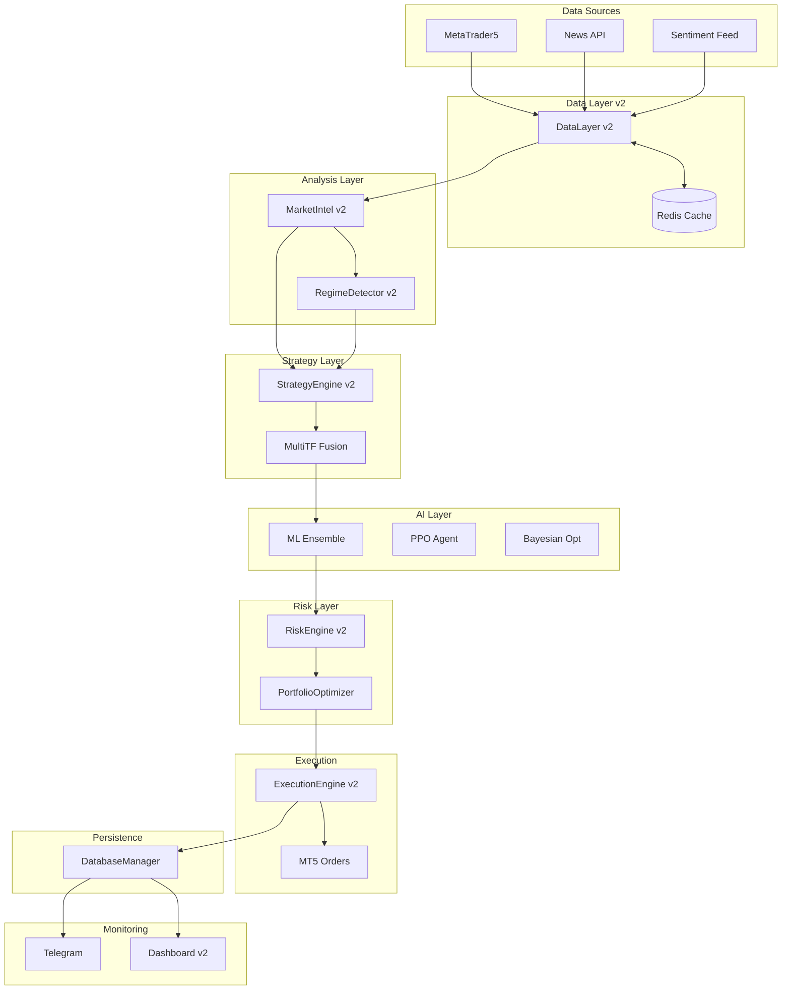

# 🏗️ ANALYSIS_ARCHITECTURE.md
## KorBot X Enhanced — Architecture Analysis
**Version:** 2.0 | **Analysis Date:** March 2026

---

## System Architecture Overview

```
┌─────────────────────────────────────────────────────────────┐
│                     KorBotX (main.py)                        │
│  Orchestrator — 1-second main loop + daily scheduler         │
└──────────────────────┬──────────────────────────────────────┘
                       │
         ┌─────────────┼──────────────────────┐
         ▼             ▼                      ▼
   ┌──────────┐  ┌──────────────┐    ┌─────────────────┐
   │DataLayer │  │MarketIntel   │    │TelegramNotifier │
   │MT5+Cache │  │30+ Indicators│    │Async Queue      │
   └────┬─────┘  └──────┬───────┘    └─────────────────┘
        │               │
        └───────┬────────┘
                ▼
        ┌───────────────┐
        │StrategyEngine │
        │4 Strategies   │
        └───────┬───────┘
                │
                ▼
        ┌───────────────┐
        │AIOptimization │
        │XGBoost+PPO+Bay│
        └───────┬───────┘
                │
                ▼
        ┌───────────────┐      ┌────────────────┐
        │RiskEngine     │─────▶│ExecutionEngine │
        │CB+Sizing+SL   │      │MT5 Orders      │
        └───────────────┘      └────────┬───────┘
                                        │
                               ┌────────▼───────┐
                               │DatabaseManager │
                               │SQLite + Redis  │
                               └────────────────┘
```

---

## Data Flow Analysis

### 1. Data Entry Path
```
MT5 Terminal
    │
    ▼
DataLayer.get_historical_data(symbol, tf, 200 bars)
    │
    ├── LRUCache hit? → Return cached (TTL 60s)
    │
    └── Cache miss → mt5.copy_rates_from_pos() → pd.DataFrame
                                                      │
                                                      ▼
                                          MarketIntel.calculate_all_indicators()
                                              ├── Trend (EMA, MACD, ADX, Ichimoku)
                                              ├── Momentum (RSI, Stochastic, MFI)
                                              ├── Volatility (ATR, BB, Keltner)
                                              ├── Volume (OBV, CMF, VWAP)
                                              └── Custom (Momentum, Regime Score)
```

### 2. Signal Generation Path
```
df_dict {M1, M5, H1, H4} + MarketRegime
    │
    ▼
StrategyEngine.generate_signals()
    ├── ScalpingStrategy(M1) → EMA crossover check → Signal | None
    ├── MeanReversionStrategy(M5) → BB+RSI+Stoch → Signal | None
    ├── BreakoutStrategy(H1) → S/R+ATR+Volume → Signal | None
    └── AdaptiveSwingStrategy(H4) → EMA+MACD+ADX → Signal | None
                                            │
                                            ▼
                                  AIOptimizationEngine.enhance_signal()
                                      ├── FeatureEngineering.create_features()
                                      └── XGBoostConfidence.predict_confidence()
                                              → signal.confidence updated
```

### 3. Execution Pipeline
```
Signal (confidence ≥ 0.65)
    │
    ▼
RiskEngine.can_open_position()
    ├── Max positions check (≤3)
    ├── Symbol exposure check (≤3%)
    └── Circuit breaker + drawdown check
                │
                ▼
RiskEngine.calculate_position_size()
    └── (account_balance × risk%) / (SL_pips × pip_value)
                │
                ▼
ExecutionEngine.execute_signal()
    ├── mt5.order_send() → market order
    ├── Trade object created
    └── DatabaseManager.save_trade()
         └── TelegramNotifier.notify_trade_opened()
```

### 4. Position Management Path
```
Every 1-second tick:
    │
    ▼
ExecutionEngine.check_stop_loss_take_profit()
    └── For each open_trade:
        ├── SL hit? → close_position()
        └── TP hit? → close_position()

ExecutionEngine.update_trailing_stop()
    └── For each open_trade:
        └── Price moved ATR×1.5 in favor? → modify SL
```

---

## Component Interaction Matrix

| Component | Reads From | Writes To |
|-----------|-----------|-----------|
| `main.py` | All | ExecutionEngine, DB, Notifier |
| `DataLayer` | MT5 | LRUCache |
| `MarketIntel` | DataLayer output | Returns enriched DataFrame |
| `StrategyEngine` | MarketIntel output | Returns Signal list |
| `AIOptimization` | StrategyEngine Signals, DataFrame | Returns enhanced Signal |
| `RiskEngine` | AccountInfo, Signal | Returns sizing/permission |
| `ExecutionEngine` | Signal, RiskEngine, DataLayer | MT5 orders, open_trades dict |
| `DatabaseManager` | Trade dicts | SQLite, Redis |
| `TelegramNotifier` | Trade/stats dicts | Telegram API |

---

## Performance Bottleneck Identification

```
┌─────────────────────────────────────────────────────────────┐
│ BOTTLENECK ANALYSIS (per 1-second tick)                     │
├──────────────────────┬────────────┬─────────────────────────┤
│ Component            │ Est. Time  │ Issue                   │
├──────────────────────┼────────────┼─────────────────────────┤
│ MT5 historical fetch │ 50–200ms   │ Synchronous API call    │
│ Indicator calculation│ 20–80ms    │ Pandas, 4 timeframes    │
│ XGBoost inference    │ 5–20ms     │ OK for current use      │
│ MT5 order placement  │ 50–500ms   │ Network + broker lag    │
│ SQLite write         │ 5–30ms     │ WAL mode helps          │
│ Telegram notify      │ ~0ms async │ Async queue, OK         │
│ Redis cache ops      │ 1–5ms      │ OK                      │
├──────────────────────┼────────────┼─────────────────────────┤
│ TOTAL (worst case)   │ ~900ms     │ Risk of missing ticks   │
└──────────────────────┴────────────┴─────────────────────────┘
```

**Critical Finding:** In a 1-second loop, worst-case total latency approaches the loop interval, meaning missed ticks during high-frequency strategies (M1 scalping). The solution is async data fetching and parallel indicator calculation.

---

## State Management

### Current State (In-Memory Only)
```python
KorBotX:
  running: bool
  paused: bool
  session_start: datetime
  trades_today: int

ExecutionEngine:
  open_trades: Dict[int, Trade]   ← LOST ON RESTART ⚠️

RiskEngine:
  metrics: RiskMetrics            ← LOST ON RESTART ⚠️
  circuit_breaker: CircuitBreaker ← LOST ON RESTART ⚠️
```

**Issue:** Restarting the bot loses all position tracking and risk metrics. If a position is open when the bot crashes, it cannot manage it after restart.

**Solution:** Persist `open_trades` and `RiskMetrics` in Redis on every update.

---

## Error Propagation Analysis

```
MT5 Connection Loss
    → DataLayer returns None
    → _generate_and_execute_signals() logs warning, returns
    → No crash, bot continues ✅ (but skips signal generation)

XGBoost prediction failure
    → @safe_execution returns default_return
    → Signal confidence falls back to strategy base ✅

MT5 order rejection
    → ExecutionEngine logs error, returns None
    → No trade object created, DB/Telegram not triggered ✅

Circuit breaker trigger
    → can_trade() returns False
    → Trading paused, Telegram notification sent ✅

Unhandled exception in trading loop
    → Critical error logged
    → Telegram error notification
    → bot.stop() called → graceful shutdown ✅
```

---

## Logging / Monitoring

### Current
- JSON-formatted logs to rotating files (10MB × 5)
- Separate files: `korbot.log`, `trades.log`, `errors.log`, `performance.log`
- Console output with colorized levels
- `PerformanceTimer` context manager for component timing

### Gaps
- No real-time alerting on log error spike
- No Prometheus/Grafana metrics endpoint
- No distributed tracing (correlation IDs across components)
- No automated log analysis or anomaly detection

---

## v2 Architecture Target (Mermaid)


